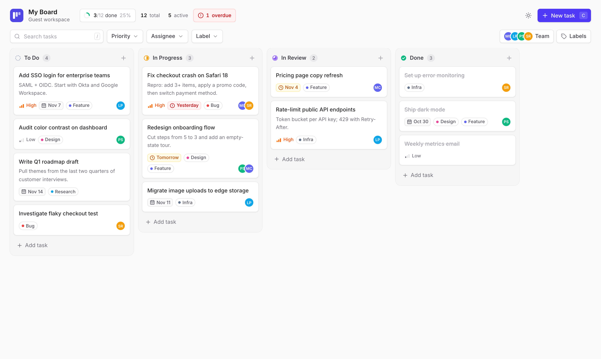
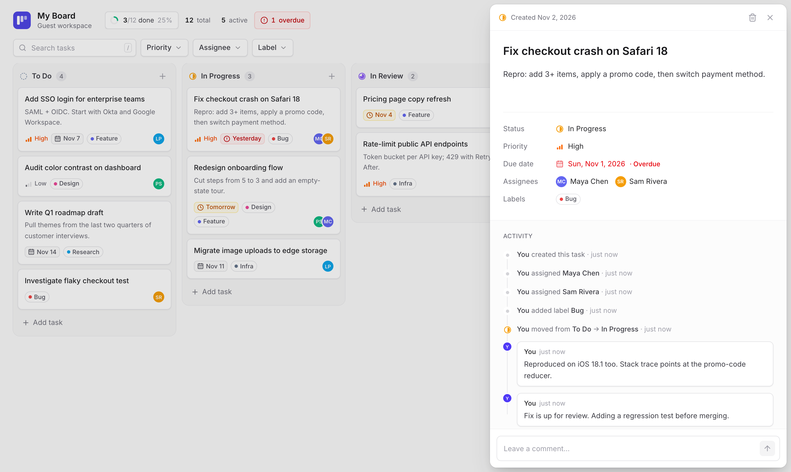
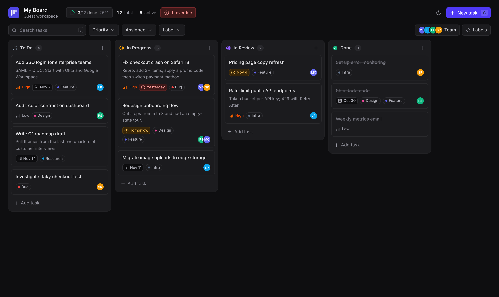
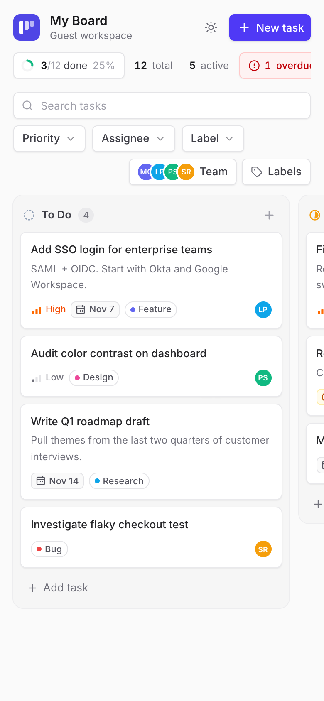

# Taskboard

A Kanban task board in the spirit of Linear and Asana. You can drag work across **To Do → In Progress → In Review → Done**, assign teammates, tag tasks with labels, comment, and see a full history of every change. Each visitor automatically gets a private guest workspace, and Postgres Row Level Security guarantees nobody else can read or touch it.

**Live demo:** https://nextplay-kanban-chi.vercel.app



| Task detail | Dark mode | Mobile |
|---|---|---|
|  |  |  |

## Features

- **Drag and drop:** move cards between columns or reorder them within a column with mouse, touch (long-press) or keyboard (Space to lift, arrow keys to move). The drop is shown instantly and saved in the background, and the card returns to its original spot if the save fails.
- **Guest accounts:** a guest session is created automatically on first visit with Supabase anonymous sign-in. Tasks, teammates and labels all belong to that guest.
- **Task detail panel:** edit the title and description in place; change status, priority and due date from menus; and see comments and the change history together in one timeline.
- **Team members and assignees:** add teammates with a name and color, assign several to a task, and see their avatars on cards.
- **Labels:** create colored labels, apply several to a task, and filter the board by them.
- **Activity log:** Postgres triggers record every status change, edit, assignment and label change, e.g. "moved from To Do → In Progress · 2 hours ago".
- **Due-date badges:** amber when a task is due within 2 days, red when overdue (except for tasks already done).
- **Search and filters:** search by title, filter by priority, assignee (including "Unassigned") and label, and see the result count.
- **Board stats:** a completion ring, totals, active work, and an overdue count you can click to show only overdue tasks.
- **Live sync:** changes appear in other open tabs and devices within about a second, via Supabase Realtime.
- **Polish:** light and dark themes (follows the system by default), keyboard shortcuts (`C` new task, `/` search, `Esc` close), loading placeholders, empty and error states, toast messages that explain what went wrong, reduced-motion support, and a responsive layout.

## Stack

| | |
|---|---|
| Frontend | React 19, TypeScript, Vite, Tailwind CSS v4 |
| Data | TanStack Query (caching and instant UI updates) with `@supabase/supabase-js` |
| Interaction | dnd-kit (drag and drop), Radix UI (dialogs, menus, popovers) |
| Backend | Supabase: Postgres, anonymous Auth, RLS, Realtime. The browser talks to Supabase directly; there is no custom API server. |
| Hosting | Vercel (deploys automatically from `main`) |

## How it works

- **Ordering:** each card stores a decimal `position`. Dropping a card between two others gives it the midpoint of their positions, so a move updates exactly one row.
- **Instant updates:** every write updates the TanStack Query cache first and calls Supabase second, so the screen never waits for the network. On failure only that task is reverted, and a toast explains the error. Task IDs are generated in the browser, so a new card can be dragged or edited before its insert finishes.
- **Ordered writes:** all writes go through one ordered queue (TanStack Query's mutation `scope`). This prevents races such as editing a card before its insert reaches the database, or assigning a teammate before the teammate row exists.
- **The database writes the activity log:** triggers on `tasks`, `task_assignees` and `task_labels` add rows to `task_activity`. Clients can read that table but have no permission to write to it, so the history can't be skipped or faked.
- **Live sync:** one Realtime channel listens to every table. When something changes, the hook refreshes only the affected data, after a short delay so bursts of changes are handled together. It waits while local saves are still in progress, so a refresh can't overwrite a change you just made.

## Security

- RLS is enabled on every table. Each policy allows a user to see and change only rows where `user_id = auth.uid()`.
- Link tables (task assignees, task labels) and comments also check that the parent task, teammate or label belongs to the same user. Otherwise someone could attach their rows to another user's task by guessing its ID.
- Activity rows are written only by the database triggers, which run with elevated privileges; clients can only read them. The trigger functions can't be called through the API.
- The frontend uses only the public publishable (anon) key. No service-role key exists anywhere in the repo or its history.
- [`scripts/rls-check.sh`](scripts/rls-check.sh) signs in two real guest accounts against the live API and confirms that guest B can't read, edit, delete, comment on, or forge ownership of guest A's tasks.

## Run locally

Requires Node 20+ and a Supabase project (the free tier is fine).

```bash
npm install
cp .env.example .env.local   # then fill in the two values below
```

```env
VITE_SUPABASE_URL=https://<project-ref>.supabase.co
VITE_SUPABASE_PUBLISHABLE_KEY=sb_publishable_...   # the public anon key, never the service-role key
```

1. Apply the SQL in [`supabase/migrations/`](supabase/migrations) in order, using the Supabase SQL editor or `supabase db push`.
2. In the Supabase dashboard, open **Authentication → Sign In / Providers** and turn on **Allow anonymous sign-ins**.
3. Run `npm run dev` and open http://localhost:5173.

Other scripts: `npm run build` (type-check and production build), `npm run lint`, `scripts/rls-check.sh` (RLS isolation check against the project in `.env.local`).

## Project structure

```
src/
  auth/           Guest session bootstrap (anonymous sign-in, guarded against double-creation)
  hooks/          Data layer: tasks, teammates and labels, comments and activity, realtime sync
  components/
    board/        Board (drag-and-drop logic), Column, TaskCard, loading skeleton
    panel/        Task detail panel, property menus, activity/comment feed
    ...           Header and stats, Toolbar and filters, pickers, dialogs, theme menu
  lib/            Types, filtering, card positions, colors, theme, Supabase client
supabase/migrations/   Schema, RLS policies, triggers, realtime publication
```
